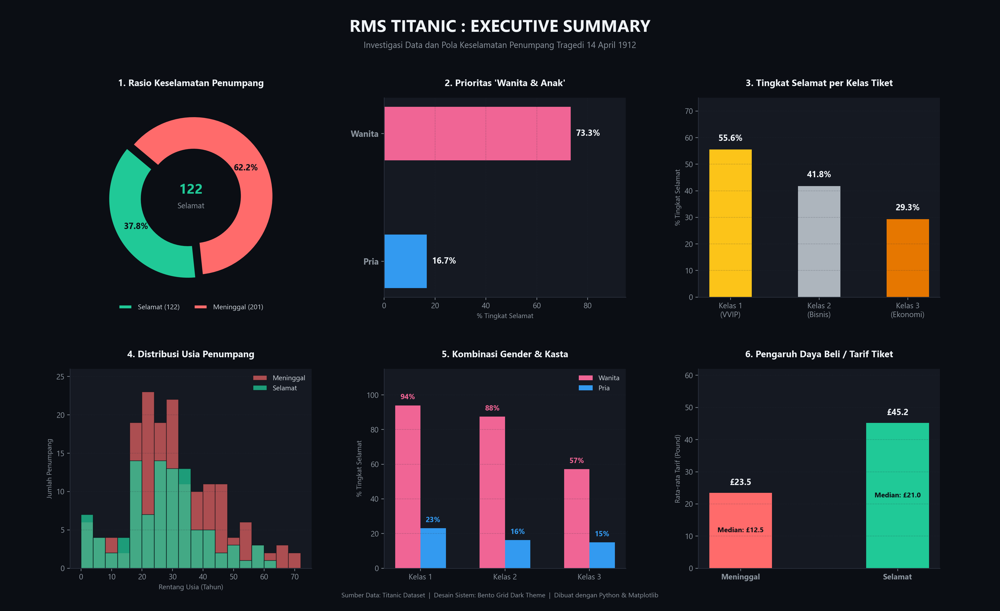

# 🧠 Machine Learning & Data Science Journey (BY LEARNING)

Repository ini mendokumentasikan proses belajar terstruktur dari konsep dasar Machine Learning, pemahaman filosofis & etika data, hingga implementasi koding eksplorasi data (*Exploratory Data Analysis*) dan visualisasi data tingkat lanjut menggunakan Python.

---

## 🎨 Showcase: Dashboard Eksekutif Tragedi Kapal Titanic

Berikut adalah hasil investigasi data keselamatan penumpang kapal Titanic (14 April 1912) yang divisualisasikan dalam bentuk **Dark-Theme Bento Grid** presisi tinggi:



---

## 📂 Arsitektur Direktori Repository

Struktur folder dirancang terorganisir per modul agar memudahkan pembelajaran materi, pembacaan kode program, dan akses dataset:

```text
BY LEARNING/
├── 01-fondasi-machine-learning/        # Teori dasar, sejarah, etika AI, dan panduan koding
│   ├── 01-pengenalan-machine-learning.md
│   ├── 02-sejarah-machine-learning.md
│   ├── 03-etika-dan-bias-dalam-ai.md
│   └── 04-persiapan-lingkungan-koding.md
│
├── 02-regresi-linier-labu/              # Praktik algoritma regresi linier pertama (US Pumpkins)
│   ├── panduan-regresi-linier.md
│   ├── latihan_regresi_labu.py
│   └── grafik_prediksi_labu.png
│
├── 03-eksplorasi-data-titanic/         # Studi kasus data & visualisasi aesthetic Titanic
│   ├── 01-roadmap-dataset-pemula.md
│   ├── 02-panduan-eksplorasi-titanic.md
│   ├── 03-panduan-visualisasi-estetis.md
│   ├── step1_titanic.py
│   ├── step2_titanic.py
│   ├── step3_titanic.py
│   ├── visualisasi_titanic.py
│   └── dashboard_titanic.png
│
├── data/                                # Centralized raw datasets
│   ├── titanic.csv
│   └── US-pumpkins.csv
│
├── .gitignore
└── README.md
```

---

## 📚 Rincian Modul Pembelajaran

### 1. [01-fondasi-machine-learning/](01-fondasi-machine-learning/)
* **[01-pengenalan-machine-learning.md](01-fondasi-machine-learning/01-pengenalan-machine-learning.md)**: Intuisi dasar, perbedaan pemrograman biasa vs ML, dan taksonomi pembelajaran mesin.
* **[02-sejarah-machine-learning.md](01-fondasi-machine-learning/02-sejarah-machine-learning.md)**: Dari Alan Turing, AI Winter, hingga ledakan Big Data & Deep Learning modern.
* **[03-etika-dan-bias-dalam-ai.md](01-fondasi-machine-learning/03-etika-dan-bias-dalam-ai.md)**: Studi kasus bias algoritma kredit perbankan, keadilan data, dan prinsip model akuntabel.
* **[04-persiapan-lingkungan-koding.md](01-fondasi-machine-learning/04-persiapan-lingkungan-koding.md)**: Setup Python, environment, dan pustaka data science.

### 2. [02-regresi-linier-labu/](02-regresi-linier-labu/)
* **[panduan-regresi-linier.md](02-regresi-linier-labu/panduan-regresi-linier.md)**: Panduan langkah demi langkah memodelkan harga labu berdasarkan hari panen.
* **Kode Program**: [`latihan_regresi_labu.py`](02-regresi-linier-labu/latihan_regresi_labu.py)
* **Grafik Output**: [`grafik_prediksi_labu.png`](02-regresi-linier-labu/grafik_prediksi_labu.png)

### 3. [03-eksplorasi-data-titanic/](03-eksplorasi-data-titanic/)
* **Dokumentasi Panduan**:
  * [`01-roadmap-dataset-pemula.md`](03-eksplorasi-data-titanic/01-roadmap-dataset-pemula.md): 10 rekomendasi dataset dunia nyata untuk pemula.
  * [`02-panduan-eksplorasi-titanic.md`](03-eksplorasi-data-titanic/02-panduan-eksplorasi-titanic.md): Investigasi data dan latar belakang tragedi Titanic.
  * [`03-panduan-visualisasi-estetis.md`](03-eksplorasi-data-titanic/03-panduan-visualisasi-estetis.md): Bedah data storytelling & layout engineering dashboard.
* **Kode Program Eksplorasi**:
  * [`step1_titanic.py`](03-eksplorasi-data-titanic/step1_titanic.py): Pengecekan bentuk data dan rasio keselamatan total.
  * [`step2_titanic.py`](03-eksplorasi-data-titanic/step2_titanic.py): Analisis keselamatan berdasarkan jenis kelamin (Gender).
  * [`step3_titanic.py`](03-eksplorasi-data-titanic/step3_titanic.py): Analisis kasta penumpang berdasarkan kelas tiket (Pclass).
  * [`visualisasi_titanic.py`](03-eksplorasi-data-titanic/visualisasi_titanic.py): Script pembuat 6-panel dashboard aesthetic dark mode.

---

## 🚀 Cara Menjalankan Kode Secara Mandiri

### 1. Kloning Repository
```bash
git clone https://github.com/dimsdevv/by-learning.git
cd by-learning
```

### 2. Pasang Pustaka yang Dibutuhkan
```bash
pip install pandas matplotlib seaborn scikit-learn numpy
```

### 3. Jalankan Script yang Diinginkan
* Menjalankan analisis Regresi Labu:
  ```bash
  python 02-regresi-linier-labu/latihan_regresi_labu.py
  ```
* Menjalankan visualisasi Titanic:
  ```bash
  python 03-eksplorasi-data-titanic/visualisasi_titanic.py
  ```

---

Dikelola dan dipelajari oleh **Dimas Sholihul Hadi** ([@dimsdevv](https://github.com/dimsdevv))
